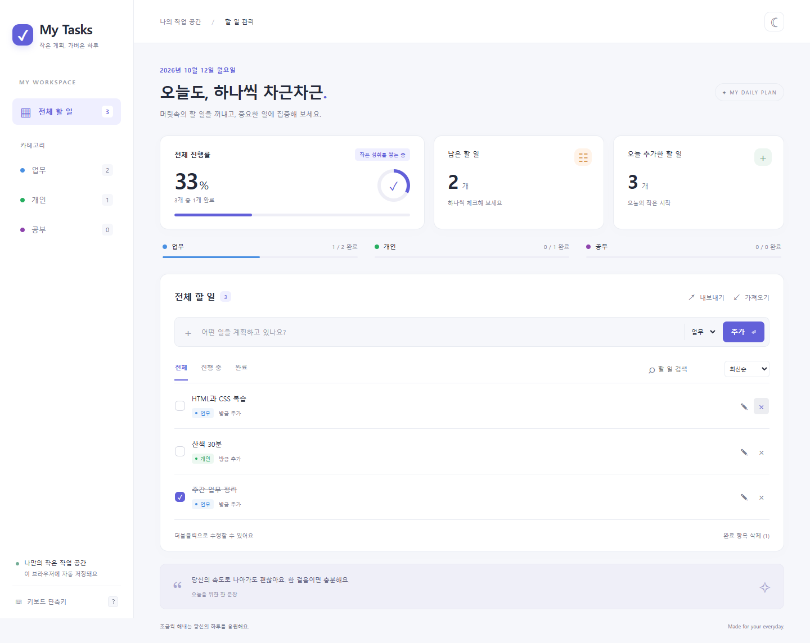

# My Tasks — 개인용 할 일 관리

`mytask.pdf`의 5단계 요구사항을 구현한 순수 HTML, CSS, JavaScript 앱입니다.



## 실행

`index.html`을 Chrome 또는 Edge에서 열면 바로 사용할 수 있습니다. 서버, 빌드, 패키지 설치가 필요 없습니다. `index.html`, `style.css`, `script.js`를 같은 폴더에 두세요.

저장소를 다운로드하려면 GitHub의 **Code → Download ZIP**을 선택해 압축을 풀거나 다음 명령을 실행하세요.

```sh
git clone https://github.com/bestash1278/mytask.git
cd mytask
```

이후 내려받은 폴더의 `index.html`을 더블클릭하세요. 화면 예시의 할 일은 테스트 데이터이며, 처음 실행하면 빈 목록으로 시작합니다.

## 기능

- 할 일 추가, 완료 체크, 수정, 삭제 및 삭제 직후 되돌리기
- 업무(파랑), 개인(초록), 공부(보라) 카테고리와 필터
- 전체·카테고리별 진행률, 남은 개수, 오늘 추가한 개수
- 검색과 전체·진행 중·완료 필터
- 더블클릭 또는 수정 버튼으로 내용·카테고리 편집, Enter 저장, Esc 취소
- 라이트·다크 모드 및 정렬 설정 저장
- 완료 항목 일괄 삭제 전 확인
- 최신순, 오래된순, 카테고리순, 미완료순, 직접 정렬
- 직접 정렬에서 드래그 또는 위·아래 버튼으로 이동 (모바일은 버튼 사용)
- 전체 목록 JSON 내보내기·가져오기, 복원 전 현재 목록 백업 옵션
- 랜덤 응원 문장, 모바일 대응, 키보드 접근성

단축키: **Alt+N** 새 할 일 입력, **Alt+1~4** 전체·업무·개인·공부 전환. 데스크톱 왼쪽 아래 또는 입력창 밖에서 **?**로 도움말을 엽니다.

## 데이터 저장

할 일은 현재 브라우저의 `localStorage`에 자동 저장됩니다. 새로고침하거나 같은 브라우저로 다시 열어도 유지됩니다. 다른 기기나 브라우저와 자동 동기화되지는 않습니다. 브라우저 데이터 삭제, 시크릿 모드 종료, 파일 위치 변경으로 저장 데이터에 접근하지 못할 수 있으므로 중요한 목록은 **내보내기**로 보관하세요.

가져오기는 현재 목록을 파일의 전체 목록으로 교체합니다. 확인 창에서 현재 목록을 먼저 JSON으로 다운로드할 수 있습니다. 잘못된 파일은 기존 목록을 변경하지 않습니다.

백업 형식:

```json
{
  "version": 1,
  "tasks": [
    {
      "id": "고유 ID",
      "text": "할 일 내용",
      "category": "work",
      "completed": false,
      "createdAt": "2026-10-12T00:00:00.000Z"
    }
  ]
}
```

`category`는 `work`, `personal`, `study` 중 하나입니다. 배열 자체도 가져올 수 있으며, 항목의 배열 순서가 직접 정렬 순서입니다.

## 파일

- `index.html`: 화면 및 접근성 구조
- `style.css`: 반응형 디자인과 다크 모드
- `script.js`: 데이터 처리·저장·이벤트
- `README.md`: 실행 방법과 사용 안내
- `docs/screenshot.png`: 데스크톱 화면 예시

원본 요구사항 문서, 문서 추출 결과, 개발 과정의 도구와 패키지 캐시는 `.gitignore`로 제외했습니다.

## 검증

Chrome 자동화 테스트로 16개 기능 검증 항목을 통과했습니다. 추가·수정·완료·삭제 및 되돌리기, 필터·검색, 새로고침 후 데이터 유지, 테마·정렬 저장, 단축키, 드래그 이동, JSON 백업·복원, 잘못된 파일 처리와 텍스트의 안전한 표시를 확인했습니다.

320~1440px 화면 너비에서 가로 넘침이 없음을 확인했고, 1,000개 항목의 렌더링·검색·진행률 계산도 검증했습니다. 모바일 레이아웃은 브라우저 화면 크기를 변경해 확인했으며 실제 모바일 기기 검증은 포함하지 않습니다.
